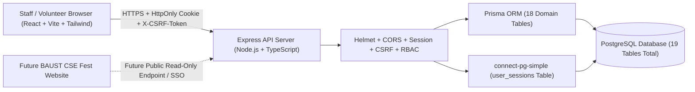
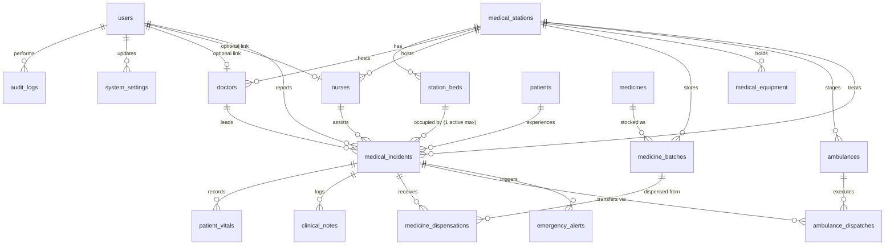
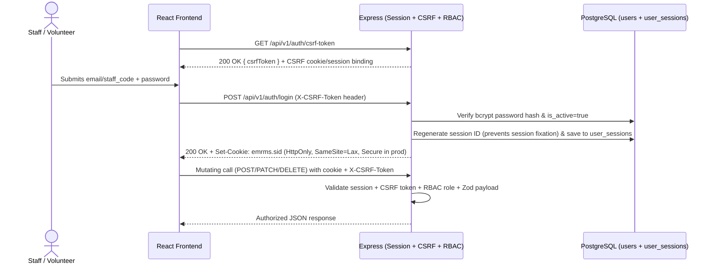

# EMRMS — Complete Technical Architecture Proposal (Revision 2)

**Project:** Event Medical & Resource Management System (EMRMS) — *BAUST CSE Fest Edition*  
**Design Reference (Read-Only):** `Design-reference/stitch_event_medical_management_system/`  
**Status:** Revised Architecture Proposal — Ready for Final Approval *(No code written, no packages installed, no database tables created)*

> [!IMPORTANT]
> **Academic & Demo Safety Notice:** EMRMS is a **student DBMS and full-stack software engineering project** built using **synthetic demo data only**. It is **not** a certified clinical Electronic Health Record (EHR), HIPAA/BMDC-certified platform, or life-critical emergency dispatch system, and must not be used for real medical care. Healthcare-inspired security practices (least-privilege RBAC, audit trails, transactional integrity) are implemented as rigorous software engineering discipline.

> [!NOTE]
> The original Google Stitch export inside `Design-reference/` remains completely untouched as a read-only visual specification.

---

## 1. High-Level System Overview

EMRMS is a standalone web application that unifies the 12 unique exported Stitch screens plus 3 newly planned governance screens into one cohesive 15-screen full-stack platform, with clean boundaries for future integration into the BAUST CSE Fest website.



---

## 2. Final Technology Stack Decisions

All proposed core technologies are approved and well-suited for this project. Below is the finalized stack with a beginner-friendly explanation of each choice.

### 2.1 Approved Core Stack & Essential Helpers

| Layer | Final Choice | Why We Use It (Simple Explanation) |
|---|---|---|
| **Frontend UI** | **React 19 + TypeScript** | Lets us build reusable UI pieces (`Sidebar`, `KpiCard`, `DataTable`) once instead of repeating HTML across 15 screens, with TypeScript catching typos and mismatched data early. |
| **Build Tool** | **Vite** | Instant local dev server, clean production builds, and built-in `/api` dev proxy so frontend and backend communicate smoothly without CORS friction. |
| **Styling & UI** | **Tailwind CSS + shadcn/ui** | Reuses ~85–90% of the Stitch Tailwind classes directly while replacing the slow Play CDN with a compiled CSS build; `shadcn/ui` provides accessible modals, dialogs, dropdowns, and drawers tailored to the *Architectural Command* theme. |
| **Routing** | **React Router** | Connects all 15 screens cleanly (`/login`, `/dashboard`, `/incidents`, `/patients/:id`, etc.) and enforces route guards by user role. |
| **Frontend Data** | **TanStack Query** *(helper)* | Manages API loading/error states, caching, and 5–10s polling on Dashboard & Alerts without manual `useEffect` bugs. |
| **Backend Server** | **Node.js (LTS) + Express + TypeScript** | Same language as the frontend (TypeScript), lightweight, transparent, and easy to organize into clean layers (`routes` → `controllers` → `services`). |
| **Database & ORM** | **PostgreSQL + Prisma ORM** | PostgreSQL provides strict relational integrity (Foreign Keys, UNIQUE constraints, partial indexes, ACID transactions) ideal for DBMS coursework; Prisma provides readable schema definitions, SQL migrations, and type-safe queries. |
| **Auth & Security** | **express-session + connect-pg-simple + CSRF + bcrypt + helmet + Zod** | Server-side sessions stored in PostgreSQL (instant remote logout), explicit CSRF token validation, bcrypt password hashing, security headers via `helmet`, and strict input validation via `Zod`. |

### 2.2 Key Trade-Offs (Advantages vs. Disadvantages)

- **Advantages:** One language across the stack (TypeScript); seamless styling migration from Stitch Tailwind HTML; genuine relational DBMS normalization & ACID transactions in PostgreSQL; revocable server-side sessions safer than `localStorage` JWTs; clean REST API ready for future Fest integration.
- **Disadvantages & Mitigations:**
  - *Two dev servers (Vite + Express):* Mitigated via Vite's `/api` proxy and simple start scripts.
  - *TypeScript strictness for beginners:* Mitigated by Prisma auto-generating database types and keeping API DTO interfaces clear and minimal.
  - *Express has no built-in structure:* Mitigated by enforcing the 4-layer module layout in Section 4.

---

## 3. Monorepo & Frontend Folder Architecture

```text
D:\DBMS LAB\
├── Design-reference/                  # READ-ONLY: Original Stitch export (untouched)
│   └── stitch_event_medical_management_system/
├── frontend/                          # Unified React + Vite + Tailwind SPA
│   ├── public/
│   │   ├── emrms-logo.svg             # Local logo (fixes broken Stitch logo URL)
│   │   └── favicon.svg
│   ├── src/
│   │   ├── app/
│   │   │   ├── App.tsx                # Root providers (Router, QueryClient, AuthProvider)
│   │   │   ├── router.tsx             # All 15 routes + ProtectedRoute + RoleGuard
│   │   │   └── navigation.ts          # Single source of truth for sidebar links, icons & roles
│   │   ├── styles/
│   │   │   ├── globals.css            # Tailwind directives + Architectural Command CSS tokens
│   │   │   └── fonts.css              # Bundled/clean Geist, Hanken Grotesk, Material Symbols
│   │   ├── components/
│   │   │   ├── ui/                    # shadcn/ui primitives (Button, Dialog, Table, Select, Sheet)
│   │   │   ├── layout/                # Shared App Shell (built ONCE for all 14 internal screens)
│   │   │   │   ├── AuthLayout.tsx     # Centered card wrapper for /login
│   │   │   │   ├── DashboardLayout.tsx# Responsive shell (Sidebar + TopHeader + <Outlet />)
│   │   │   │   ├── Sidebar.tsx        # Desktop fixed w-72 + mobile slide-over Sheet drawer
│   │   │   │   ├── TopHeader.tsx      # Search (⌘K), venue status, SOS button, profile/logout
│   │   │   │   └── CommandPalette.tsx # Global ⌘K modal (filtered by user's role permissions)
│   │   │   └── shared/                # Reusable EMRMS widgets extracted from Stitch
│   │   │       ├── PageHeader.tsx     # Breadcrumbs + title + subtitle + action cluster
│   │   │       ├── KpiCard.tsx        # Standard & critical-red KPI card
│   │   │       ├── FilterToolbar.tsx  # Search + dropdowns + filter chips + table/grid switch
│   │   │       ├── DataTable.tsx      # Responsive table + visible scroll + pagination footer
│   │   │       ├── TriageBadge.tsx    # Standardized P1 / P2 / P3 / Untriaged badges
│   │   │       ├── StatusBadge.tsx    # Operational status pills
│   │   │       ├── StationLoadCard.tsx# Bed capacity progress meter + staff summary
│   │   │       └── ActivityTimeline.tsx# Vertical timeline for logs & clinical milestones
│   │   ├── features/                  # 1 folder per business module
│   │   │   ├── auth/                  # LoginPage + AuthContext / useAuth
│   │   │   ├── dashboard/             # MainDashboardPage (role-aware view)
│   │   │   ├── alerts/                # EmergencyAlertsPage + BroadcastModal
│   │   │   ├── incidents/             # IncidentManagementPage + ReportIncidentModal
│   │   │   ├── doctors/               # DoctorManagementPage + RegisterDoctorModal
│   │   │   ├── nurses/                # NurseManagementPage + RegisterNurseModal
│   │   │   ├── patients/              # PatientDirectoryPage + PatientDetailsPage (EHR)
│   │   │   ├── medicines/             # MedicineInventoryPage + RestockModal + DispenseModal
│   │   │   ├── equipment/             # EquipmentManagementPage + RegisterEquipmentModal
│   │   │   ├── ambulances/            # AmbulanceFleetPage + DispatchModal
│   │   │   ├── stations/              # MedicalStationsPage + BedRegistryTable
│   │   │   ├── reports/               # ReportsAnalyticsPage + SurgeHistogram + CSV Export
│   │   │   ├── audit-logs/            # [NEW] ActivityAuditLogsPage
│   │   │   ├── users/                 # [NEW] UserRoleManagementPage
│   │   │   └── settings/              # [NEW] SystemSettingsPage
│   │   ├── lib/
│   │   │   ├── apiClient.ts           # Fetch wrapper: credentials:'include' + X-CSRF-Token header
│   │   │   ├── permissions.ts         # Frontend RBAC helpers matching backend policy
│   │   │   └── utils.ts               # cn() class merger + date/tabular formatters
│   │   └── types/                     # Shared TypeScript interfaces for API DTOs
│   ├── tailwind.config.ts             # Unified Architectural Command theme (rounded-full: 9999px)
│   └── vite.config.ts                 # Local dev proxy (/api -> http://localhost:4000)
└── backend/                           # Express + TypeScript + Prisma API server
```

---

## 4. Backend Folder Architecture

Every backend request follows a predictable 4-layer flow:  
**Route** → **Middleware (Session, CSRF, RBAC, Zod Validation)** → **Controller** → **Service (Business Rules + Prisma)**

```text
backend/
├── prisma/
│   ├── schema.prisma                  # Exact 19 PostgreSQL tables, enums, indexes, relations
│   ├── migrations/                    # Version-controlled SQL migrations
│   └── seed.ts                        # Reconciled synthetic demo dataset for BAUST CSE Fest
├── src/
│   ├── server.ts                      # HTTP entry point
│   ├── app.ts                         # Express pipeline (helmet, cors, session, csrf, routes, errors)
│   ├── config/
│   │   ├── env.ts                     # Zod-validated environment variables
│   │   ├── prisma.ts                  # Singleton PrismaClient
│   │   └── session.ts                 # express-session + connect-pg-simple configuration
│   ├── middleware/
│   │   ├── requireAuth.ts             # Verifies active session (401 if unauthenticated)
│   │   ├── requireRole.ts             # Enforces 6-role RBAC rules (403 if forbidden)
│   │   ├── csrfProtection.ts          # Validates X-CSRF-Token on all state-changing requests
│   │   ├── validate.ts                # Zod request body/query/params validation (400)
│   │   ├── auditLogger.ts             # Writes append-only audit_logs entries
│   │   └── errorHandler.ts            # Standardized JSON errors (hides stack traces in prod)
│   ├── modules/                       # 1-to-1 match with frontend features
│   │   ├── auth/
│   │   ├── dashboard/
│   │   ├── alerts/
│   │   ├── incidents/
│   │   ├── doctors/
│   │   ├── nurses/
│   │   ├── patients/
│   │   ├── medicines/
│   │   ├── equipment/
│   │   ├── ambulances/
│   │   ├── stations/
│   │   ├── reports/
│   │   ├── audit-logs/
│   │   ├── users/
│   │   └── settings/
│   └── utils/
│       ├── pagination.ts              # Shared pagination metadata helper
│       ├── serializers.ts             # Role-safe DTO projections (strips PHI for Volunteer/Dispatcher)
│       └── AppError.ts                # Typed HTTP error class
├── .env.example
└── package.json
```

---

## 5. Database Architecture (Exact Count: 19 Normalized PostgreSQL Tables)

In Revision 1, the table summary claimed 18 tables while listing more entities and including two potential circular foreign keys (`MedicalStation ↔ Doctor` and `MedicalIncident ↔ StationBed`) plus speculative hardware-telemetry tables.

In this revised design, we pruned non-essential v1 telemetry tables and eliminated every circular dependency. The complete, verified schema contains **exactly 19 PostgreSQL tables**:
- **18 domain tables** queried and managed by Prisma at runtime.
- **1 session table (`user_sessions`)** whose DDL/migration is owned by Prisma (`@@map("user_sessions")`) so there is zero schema drift, while runtime session storage is managed by `connect-pg-simple`.

### 5.1 Complete Table List (Exact 19 Tables)

| # | Table Name | Domain | Primary Key | Key Foreign Keys & Constraints | Nullable Fields & Design Notes |
|---|---|---|---|---|---|
| 1 | `users` | Auth & RBAC | `id` (UUID/CUID) | `UNIQUE(email)`, `UNIQUE(staff_code)`, `UNIQUE(external_auth_id)` | `staff_code`, `external_auth_id`, `last_login_at` nullable. `role` ENUM (`SUPER_ADMIN`, `MEDICAL_ADMIN`, `DOCTOR`, `NURSE`, `DISPATCHER`, `VOLUNTEER`). |
| 2 | `user_sessions` | Auth & Sessions | `sid` (`VARCHAR`) | `INDEX(expire)` — exact `connect-pg-simple` schema | Managed at runtime by `connect-pg-simple`; DDL tracked in Prisma (`createTableIfMissing: false`). |
| 3 | `audit_logs` | Governance | `id` | `actor_user_id → users.id` (`ON DELETE SET NULL`) | **Append-only** (no UPDATE/DELETE APIs). `actor_user_id`, `before_json`, `after_json`, `ip_address` nullable. |
| 4 | `system_settings` | Governance | `key` (`VARCHAR`) | `updated_by_user_id → users.id` (`ON DELETE SET NULL`) | `updated_by_user_id` nullable. Stores event name, SLA targets, polling interval as `value_json`. |
| 5 | `medical_stations` | Facilities | `id` | `UNIQUE(code)` (e.g. `ST-01`, `ST-00`) | Includes `station_type` ENUM (`FIELD_POST`, `CENTRAL_DEPOT`) so medicine batches always link to a non-null station/depot. **No FK back to `doctors` (prevents cycle).** |
| 6 | `station_beds` | Facilities | `id` | `station_id → medical_stations.id` (`ON DELETE RESTRICT`), `UNIQUE(station_id, bed_code)` | Holds `bed_code`, `status` ENUM (`AVAILABLE`, `OCCUPIED`, `MAINTENANCE`). **No `current_incident_id` FK (prevents cycle).** |
| 7 | `doctors` | Workforce | `id` | `user_id → users.id` (`UNIQUE`, `ON DELETE SET NULL`), `station_id → medical_stations.id` (`ON DELETE SET NULL`), `UNIQUE(bmdc_number)` | `user_id`, `station_id`, `radio_channel`, `phone_ext` nullable. `is_station_lead` boolean (partial unique index ensures at most 1 lead doctor per station). |
| 8 | `nurses` | Workforce | `id` | `user_id → users.id` (`UNIQUE`, `ON DELETE SET NULL`), `station_id → medical_stations.id` (`ON DELETE SET NULL`), `UNIQUE(bnmc_number)`, `UNIQUE(vhf_callsign)` | `user_id`, `station_id`, `vhf_callsign` nullable. `is_rapid_responder` boolean. *(Live GPS columns deferred to v2.)* |
| 9 | `patients` | Clinical | `id` | `UNIQUE(record_code)` (e.g. `PT-4091`), `INDEX(institutional_id)` | `blood_group`, `institutional_id`, `emergency_contact_name`, `emergency_contact_phone`, `allergies_notes`, `medical_history_notes` nullable. Restricted by RBAC. |
| 10 | `medical_incidents` | Clinical Core | `id` | `UNIQUE(incident_code)`, `patient_id → patients.id` (`ON DELETE RESTRICT`), `station_id → medical_stations.id` (`ON DELETE SET NULL`), `bed_id → station_beds.id` (`ON DELETE SET NULL`), `lead_doctor_id → doctors.id` (`ON DELETE SET NULL`), `lead_nurse_id → nurses.id` (`ON DELETE SET NULL`), `reported_by_user_id → users.id` (`ON DELETE SET NULL`) | `patient_id` is **nullable** when a Volunteer first reports an incident (linked/registered by Nurse or Doctor at triage). `bed_id`, `station_id`, `lead_doctor_id`, `lead_nurse_id`, `hpi_notes`, `gcs_score`, `discharge_checklist_json`, `discharged_at` nullable. **Partial Unique Index** on `(bed_id)` where `bed_id IS NOT NULL AND status <> 'DISCHARGED'`. |
| 11 | `patient_vitals` | Clinical | `id` | `incident_id → medical_incidents.id` (`ON DELETE CASCADE`), `recorded_by_user_id → users.id` (`ON DELETE SET NULL`) | Time-series readings (`heart_rate`, `bp_systolic`, `bp_diastolic`, `spo2`, `temp_c`, `resp_rate`, `glucose_mgdl`) — individual measurements nullable so partial vitals can be logged quickly. |
| 12 | `clinical_notes` | Clinical | `id` | `incident_id → medical_incidents.id` (`ON DELETE CASCADE`), `author_user_id → users.id` (`ON DELETE SET NULL`) | Powers EHR timeline milestones (`FIELD_RESPONSE`, `STATION_TRANSFER`, `INTERVENTION`, `ASSESSMENT`, `DIAGNOSTIC_NOTE`, `DISCHARGE`). |
| 13 | `medicines` | Pharmacy | `id` | `UNIQUE(sku_code)` | Catalog metadata (`name`, `generic_name`, `category`, `storage_requirement`, `is_controlled`, `unit_label`, `min_par_level`). |
| 14 | `medicine_batches` | Pharmacy | `id` | `medicine_id → medicines.id` (`ON DELETE RESTRICT`), `station_id → medical_stations.id` (`ON DELETE RESTRICT`), `UNIQUE(medicine_id, station_id, batch_number)` | Tracks `quantity`, `max_quantity`, `expiry_date` per station or Central Depot (`station_id` is NOT NULL, avoiding SQL `NULL` uniqueness issues). |
| 15 | `medicine_dispensations` | Pharmacy | `id` | `incident_id → medical_incidents.id` (`ON DELETE RESTRICT`), `batch_id → medicine_batches.id` (`ON DELETE RESTRICT`), `administered_by_user_id → users.id` (`ON DELETE SET NULL`), `verified_by_user_id → users.id` (`ON DELETE SET NULL`) | `verified_by_user_id` nullable for standard meds, **enforced required & different from `administered_by_user_id`** in service layer when `medicine.is_controlled = true`. |
| 16 | `medical_equipment` | Logistics | `id` | `UNIQUE(asset_code)`, `UNIQUE(serial_number)`, `station_id → medical_stations.id` (`ON DELETE SET NULL`) | `station_id`, `battery_pct`, `last_inspected_at`, `next_audit_due`, `notes` nullable. *(Automated RF mesh sweeps deferred to v2; manual inspection logging in v1.)* |
| 17 | `ambulances` | Fleet | `id` | `UNIQUE(callsign)`, `UNIQUE(plate_number)`, `station_id → medical_stations.id` (`ON DELETE SET NULL`) | `station_id`, `fuel_pct`, `equipment_summary` nullable. *(Real-time GPS coordinates deferred to v2.)* |
| 18 | `ambulance_dispatches` | Fleet | `id` | `ambulance_id → ambulances.id` (`ON DELETE RESTRICT`), `incident_id → medical_incidents.id` (`ON DELETE SET NULL`), `dispatched_by_user_id → users.id` (`ON DELETE SET NULL`) | `incident_id`, `eta_minutes`, `notes`, `completed_at` nullable. |
| 19 | `emergency_alerts` | Command | `id` | `incident_id → medical_incidents.id` (`ON DELETE SET NULL`), `created_by_user_id → users.id` (`ON DELETE SET NULL`), `acknowledged_by_user_id → users.id` (`ON DELETE SET NULL`) | `incident_id`, `description`, `acknowledged_by_user_id`, `acknowledged_at`, `resolved_at` nullable. |

### 5.2 Updated Entity-Relationship Diagram (Cycle-Free DAG)



### 5.3 Deep-Dive: Solving `MedicalIncident` ↔ `StationBed` & Circular Dependency Rules

1. **Zero Circular Foreign Keys:** Every table sits in a strict 4-level Directed Acyclic Graph (DAG):
   - *Level 0 (Independent):* `users`, `user_sessions`, `medical_stations`, `patients`, `medicines`
   - *Level 1 (References Level 0):* `audit_logs`, `system_settings`, `station_beds`, `doctors`, `nurses`, `medicine_batches`, `medical_equipment`, `ambulances`
   - *Level 2 (Core Clinical):* `medical_incidents`
   - *Level 3 (Incident Child Events):* `patient_vitals`, `clinical_notes`, `medicine_dispensations`, `ambulance_dispatches`, `emergency_alerts`
2. **How `StationBed` ↔ `MedicalIncident` Works Safely:**
   - Over an event, **one bed serves many incidents over time** (`1:N`), so the FK belongs strictly on `medical_incidents.bed_id → station_beds.id` (nullable for walk-ins, waiting patients, or field-only cases). `station_beds` holds **no** `current_incident_id` column.
   - **Preventing Double-Booking:** A PostgreSQL **partial unique index** enforces that at most **one active incident** can reference any `bed_id`:
     `CREATE UNIQUE INDEX uq_active_incident_bed ON medical_incidents (bed_id) WHERE bed_id IS NOT NULL AND status <> 'DISCHARGED';`
   - **Cross-Station Integrity:** Inside `prisma.$transaction`, whenever a bed is assigned to an incident, the service verifies `bed.status === 'AVAILABLE'`, sets `incident.station_id = bed.station_id`, sets `incident.bed_id = bed.id`, and marks `bed.status = 'OCCUPIED'`. On discharge or bed transfer, the old bed is atomically marked `AVAILABLE`.
3. **How `MedicalStation` Lead Doctor Works Without a Cycle:**
   - Instead of `medical_stations.lead_doctor_id → doctors.id`, `doctors` holds `is_station_lead` (boolean) with a PostgreSQL partial unique index `WHERE is_station_lead = true AND station_id IS NOT NULL` on `(station_id)`. This guarantees at most one lead doctor per station with a strictly one-way FK.

---

## 6. Session Management, Prisma Coexistence & CSRF Protection

### 6.1 How `connect-pg-simple` & Prisma Coexist Safely
A common beginner mistake is letting `connect-pg-simple` auto-create a `session` table while Prisma separately manages migrations—causing Prisma `migrate dev` to complain about database drift or drop the session table. We avoid this completely:

1. **Single Schema Definition (Prisma Owns DDL):** Define `model UserSession` inside `prisma/schema.prisma` mapped to `@@map("user_sessions")` using the exact column types `connect-pg-simple` requires (`sid String @id @db.VarChar`, `sess Json @db.Json`, `expire DateTime @db.Timestamp(6)`, plus `@@index([expire])`).
2. **Disable Auto-Creation in `connect-pg-simple`:** Configure `new PgSession({ pool, tableName: 'user_sessions', createTableIfMissing: false })`.
3. **Clear Runtime Ownership:** `express-session` + `connect-pg-simple` handle creating, reading, refreshing, and pruning sessions on every request. Our Admin `/users` service can also safely query or delete rows from `user_sessions` via Prisma to display active logins and perform **1-click remote session termination**.

### 6.2 Authentication & CSRF Protection Flow



**Security Controls Included:**
- **Cookie Flags:** `HttpOnly: true` (blocks JS/XSS theft), `SameSite: 'lax'`, `Secure: true` in production HTTPS.
- **Session Fixation Protection:** Call `req.session.regenerate()` upon successful login and `req.session.destroy()` + `res.clearCookie()` on logout.
- **Terminal Timeout:** Default session `maxAge = 2 hours`; "Remember this terminal" extends to `12 hours` (only for non-Volunteer clinical roles, if desired) and logs terminal IP in `audit_logs`.
- **Explicit CSRF Protection:** Synchronizer token pattern (e.g., `csrf-csrf` or per-session secret token sent via `X-CSRF-Token` header on every `POST`/`PUT`/`PATCH`/`DELETE`), paired with strict CORS (`origin: FRONTEND_ORIGIN`, `credentials: true`).
- **Rate Limiting & Password Hashing:** `bcrypt` (cost 12) + `express-rate-limit` on `/api/v1/auth/login` (e.g., 10 attempts per 15 min per IP).

---

## 7. Role-Based Access Control (6 Operational Roles)

All permissions are **strictly enforced on the backend** (`requireRole` middleware + role-safe response serializers). The frontend hides unauthorized navigation items only to keep the UI clean.

### 7.1 Role Definitions & Permission Matrix

| Module / Action | Super Admin (`SUPER_ADMIN`) | Medical Admin / CMO (`MEDICAL_ADMIN`) | Doctor (`DOCTOR`) | Nurse (`NURSE`) | Dispatcher (`DISPATCHER`) | Volunteer (`VOLUNTEER`) |
|---|---|---|---|---|---|---|
| **Login & Own Profile** | Yes | Yes | Yes | Yes | Yes | Yes |
| **Main Dashboard** | Full view | Full view | Full view | Full view | Operations view *(no PHI)* | **Minimal view** *(own reports + station list only)* |
| **Report New Incident** | Yes | Yes | Yes | Yes | Yes | **Yes** *(location, brief description, urgency only)* |
| **Incident Queue & Triage Update** | Full CRUD | Full CRUD | Full clinical CRUD | Create + Triage + Assign Bed | View non-PHI + Route Station | **Own submitted report status only** *(no PHI)* |
| **Patient Directory & EHR Dossier** | Full *(audited)* | Full Read/Write | Full Read/Write + Discharge Sign-off | Read + Log Vitals & Nursing Notes | **No Access** *(stripped from all APIs)* | **No Access (Strict Block)** |
| **Emergency Alerts & Broadcasts** | Full + Broadcast | Full + Broadcast | View + Acknowledge/Respond | View + Acknowledge/Respond | Full + Broadcast | **No Access** *(can only report incident)* |
| **Doctor & Nurse Rosters** | Full CRUD | Full CRUD + Reassign | View roster | View roster | View + Reassign sectors | **No Access** |
| **Medical Stations & Beds** | Full CRUD | Full CRUD | View + Assign Bed | View + Assign Bed | View + Balance Load | **Read-only station names & locations** |
| **Medicine Inventory** | Full CRUD | Full CRUD + Controlled Override | View + Order/Dispense | View + Dispense + Dual-Verify | Full Stock/Restock CRUD *(no patient Rx link)* | **No Access** |
| **Medical Equipment** | Full CRUD | Full CRUD | View | View + Log Check | Full CRUD + Maintenance | **No Access** |
| **Ambulance Fleet & Dispatches** | Full CRUD | Full CRUD | Request transfer | View | Full Dispatch CRUD | **No Access** |
| **Reports & Analytics** | Full + Export | Full + Export | View clinical summaries | View station summaries | View logistics summaries | **No Access** |
| **Activity & Audit Logs** | Full Read + Export | Read Clinical/Ops Logs | **No Access** | **No Access** | **No Access** | **No Access** |
| **User & Role Management** | Full CRUD + All Roles + Revoke Sessions | Manage Clinical/Ops Staff *(cannot edit Super Admin)* | **No Access** | **No Access** | **No Access** | **No Access** |
| **System Settings** | Full Read/Write | Edit Event & Clinical SLA Settings | **No Access** | **No Access** | **No Access** | **No Access** |

> [!CAUTION]
> **Volunteer & Dispatcher Privacy Boundary:** Backend serializers must guarantee that `VOLUNTEER` and `DISPATCHER` API responses **never return** `patients` personal/clinical fields (`allergies_notes`, `medical_history_notes`, `emergency_contact_phone`, `hpi_notes`, `patient_vitals`, `clinical_notes`). For Volunteers, `GET /api/v1/incidents/my-reports` returns only `incident_code`, `location_text`, `triage_priority`, `status`, and `created_at`.

---

## 8. REST API Architecture

- **Base Path:** `/api/v1/...`
- **Standard JSON Response:** `{ "success": true, "data": ..., "meta": { "page": 1, "limit": 10, "total": 64 } }`
- **Standard Error Response:** `{ "success": false, "error": { "code": "FORBIDDEN", "message": "..." } }`
- **Near-Real-Time Updates (v1):** TanStack Query polling (`5s–10s`) on Dashboard, Alerts, and Ambulance Fleet—simple, reliable, and works over unstable campus Wi-Fi.

| Module | Key Endpoints |
|---|---|
| **Auth** | `GET /api/v1/auth/csrf-token`, `POST /api/v1/auth/login`, `POST /api/v1/auth/logout`, `GET /api/v1/auth/me` |
| **Dashboard** | `GET /api/v1/dashboard/summary` *(role-filtered payload)* |
| **Incidents** | `POST /api/v1/incidents/report` *(Volunteer+)*, `GET /api/v1/incidents/my-reports` *(Volunteer)*, `GET/POST /api/v1/incidents`, `GET/PATCH /api/v1/incidents/:id`, `POST /api/v1/incidents/:id/assign-bed`, `POST /api/v1/incidents/:id/discharge` |
| **Patients (EHR)** | `GET/POST /api/v1/patients`, `GET/PATCH /api/v1/patients/:id`, `POST /api/v1/patients/:id/vitals`, `POST /api/v1/patients/:id/notes`, `PATCH /api/v1/incidents/:id/discharge-checklist` |
| **Alerts** | `GET/POST /api/v1/alerts`, `PATCH /api/v1/alerts/:id/acknowledge`, `PATCH /api/v1/alerts/:id/resolve` |
| **Workforce** | `GET/POST/PATCH /api/v1/doctors`, `GET/POST/PATCH /api/v1/nurses` |
| **Stations & Beds** | `GET/POST/PATCH /api/v1/stations`, `GET/POST/PATCH /api/v1/stations/:id/beds` |
| **Pharmacy** | `GET/POST /api/v1/medicines`, `POST /api/v1/medicines/batches`, `POST /api/v1/medicines/dispense` *(transactional + dual-verify check)* |
| **Equipment & Fleet** | `GET/POST/PATCH /api/v1/equipment`, `GET/POST/PATCH /api/v1/ambulances`, `GET/POST/PATCH /api/v1/ambulances/dispatches` |
| **Reports** | `GET /api/v1/reports/overview`, `GET /api/v1/reports/hourly-surge`, `GET /api/v1/reports/export/csv` |
| **Governance** | `GET /api/v1/audit-logs`, `GET/POST/PATCH /api/v1/users`, `DELETE /api/v1/users/:id/sessions`, `GET/PATCH /api/v1/settings` |

---

## 9. Scope Control: Core v1 vs. Optional Future Enhancements

To keep this project practical, well-built, and achievable without getting bogged down in hardware integrations, features are strictly separated into **v1 Core** and **Optional Future Enhancements**:

| Feature Area | Included in Core v1 (Achievable & Practical) | Deferred to Optional Future Enhancements (v2+) |
|---|---|---|
| **Screens & UI** | All 12 unique Stitch screens + 3 Governance screens, responsive shell, local logo, bug fixes. | Dark mode toggle, multi-language (Bangla/English) i18n. |
| **Location & Maps** | Campus sector/station dropdowns + clean static campus sector schematic. | Live GPS tracking (`lat`/`lng` streaming), interactive Leaflet/Google Maps tiles. |
| **Vitals & Diagnostics** | Manual clinical vitals entry (`patient_vitals`) + inline SVG trend sparklines + manual diagnostic entries in `clinical_notes`. | Real biomedical monitor integrations (Mindray/Zoll RF mesh, live ECG waveforms, dedicated lab device feeds). |
| **Pharmacy & Storage** | Medicine catalog, station/depot batches, expiry alerts, transactional dispensation, dual-user controlled-drug verification. | Automated IoT cold-chain fridge temperature probes (`cold_chain_readings`). |
| **Emergency Comms** | In-app alerts, status workflow (`ACTIVE → INTERCEPTING → RESOLVED`), 5s polling updates. | WebSockets/SSE push, live VHF radio speech-to-text CAD feeds, SMS/PA hardware broadcast, physical corridor klaxons. |
| **Security & Offline** | Session cookies in PostgreSQL, CSRF protection, 6-role RBAC, bcrypt, audit logging, clear demo-data notice. | FIDO2 / YubiKey WebAuthn hardware keys, full offline-first IndexedDB PWA sync queue. |
| **Reporting** | Real SQL analytics aggregations + CSV download + print-friendly browser PDF stylesheet. | Automated server-side PDF regulatory form generation (Puppeteer/PDFKit). |

---

## 10. Converting the 12 Stitch Screens & Planning the 3 Missing Screens

### 10.1 Stitch Conversion Summary
- Skip duplicate `main_dashboard_2`; convert the **12 unique screens** (`login_page` + 11 operational modules) into feature pages wrapped by `AuthLayout` or `DashboardLayout`.
- Apply global design fixes once: local `emrms-logo.svg`, uniform Material Symbols icons on every sidebar link, automatic URL-based active state, canonical route slugs, `borderRadius.full: '9999px'`, responsive mobile sidebar drawer, and visible horizontal scrolling on dense desktop tables.
- Add a clean **Volunteer Portal / Incident Report** view on `/dashboard` + `/incidents` when logged in as `VOLUNTEER` so volunteers immediately see a simple *"Report Campus Incident"* form and their submitted ticket status list without seeing clinical screens.
- Replace misleading Stitch demo badges (*"HIPAA/BMDC Certified"*, *"256-BIT TLS // AIR-GAPPED READY"*) with honest labels (*"EMRMS Academic Prototype • Synthetic Demo Data Only"*).

### 10.2 Blueprint for the 3 Missing Governance Screens (Architectural Command Theme)
1. **Activity & Audit Logs (`/audit-logs`):** 4 KPI cards (`Total Events 24h`, `Critical/Security Actions`, `Controlled-Med Co-Signs`, `Active Sessions`), search/action/module filters, append-only ledger table with tabular timestamps, and a slide-over JSON diff inspector.
2. **User & Role Management (`/users`):** 4 KPI cards, 8-column staff directory table (`Name/Email`, `Institutional ID`, `Role Badge` across all 6 roles, `Status`, `Last Login`, `Actions`), `+ Provision Staff Account` modal, and a 4-column right sidebar showing the **6-Role Permission Summary** + **Active Terminals** with 1-click session revocation.
3. **System Settings (`/settings`):** Clean tabbed configuration cards for **Event Cadence** (event name, active day, ambient advisory), **Triage & Stock Thresholds** (P1/P2/P3 SLA targets, low-stock warning defaults), **Session & Polling Config** (refresh interval, timeout rules), and **Future Integration Placeholders**.

---

## 11. Future Integration With the BAUST CSE Fest Website

1. **Subdomain / Reverse Proxy Ready:** Deploy EMRMS on `medical.baustcsefest.org` (or `/medical`) behind Nginx/Cloudflare with relative `/api/v1` paths.
2. **Strict Public vs. Private Boundary:** Future integration can expose a dedicated read-only public endpoint (`GET /api/v1/public/stations`) returning **only** station names, campus locations, and emergency contact numbers for Fest attendees—never touching patient or incident tables.
3. **SSO-Ready User Table:** `users.external_auth_id` (unique, nullable) allows plugging in OAuth2/OIDC Single Sign-On later without redesigning the schema.
4. **Attendee Lookup Hook:** `patients.institutional_id` (indexed) enables optional future lookup against the Fest registration system during triage intake.

---

## 12. Security, Privacy & Project Risks

| Risk | Mitigation |
|---|---|
| **Unauthorized Clinical Data Exposure** | Strict backend `requireAuth` + `requireRole` + role-safe response serializers (`serializers.ts`) ensuring `VOLUNTEER` and `DISPATCHER` never receive PHI fields. |
| **Session Hijacking / CSRF / Brute Force** | `HttpOnly` + `SameSite=Lax` + `Secure` cookies, PostgreSQL session store with instant revocation, session regeneration on login, explicit `X-CSRF-Token` validation, `bcrypt`, and login rate limiting. |
| **Bed & Medicine Race Conditions** | PostgreSQL partial unique index on active bed occupancy + `prisma.$transaction` for bed assignment and stock dispensation (preventing negative stock or double-booked beds). |
| **Controlled Medicine Misuse / Audit Tampering** | Backend enforces dual-user verification (`verified_by_user_id !== administered_by_user_id`) for `is_controlled` medicines; `audit_logs` has no update/delete endpoints. |
| **Misrepresentation as Certified Medical Software** | Explicit academic prototype disclaimer in UI footer/login and documentation; synthetic demo data only in `seed.ts`. |
| **Scope Overload** | Full architecture & 19-table schema designed up front, built incrementally in 5 manageable phases (Section 13). |

---

## 13. Incremental Implementation Phases

We finalize the complete architecture and 19-table database design first, then build and test one clean vertical slice at a time:

| Phase | Goal | Deliverables |
|---|---|---|
| **Phase 0: Foundation & Complete Schema** | Set up project structure & full PostgreSQL schema | Initialize `frontend/` (Vite + React + TS + Tailwind + shadcn/ui + local logo) and `backend/` (Express + TS + Prisma); write complete **19-table** `schema.prisma`, custom partial unique indexes, initial SQL migration, and reconciled synthetic `seed.ts`. |
| **Phase 1: Auth, Security & Unified Shell** | Secure login + shared 15-screen navigation frame | `express-session` + `connect-pg-simple` + CSRF middleware + 6-role RBAC middleware + audit logger; `/login` page; unified `DashboardLayout` (Sidebar with icons, TopHeader, mobile drawer, `CommandPalette`); shared UI primitives (`PageHeader`, `KpiCard`, `DataTable`, `FilterToolbar`, badges). |
| **Phase 2: Core Operations & Triage (MVP)** | End-to-end incident lifecycle + Volunteer safety | `/dashboard` (role-aware), `/incidents` (full triage + Volunteer quick-report flow), `/patients` & `/patients/:id` (EHR dossier, vitals, clinical notes, discharge checklist), and `/alerts` (emergency queue + broadcasts). |
| **Phase 3: Workforce, Stations & Logistics** | Complete all resource management modules | `/stations` (tactical cards + transactional bed registry), `/doctors`, `/nurses`, `/medicines` (batches + transactional dispensation + dual-verify), `/equipment`, and `/ambulances` (fleet + dispatch missions). |
| **Phase 4: Analytics & 3 Governance Screens** | Complete all 15 screens | `/reports` (live SQL aggregations, surge chart, CSV export), `/audit-logs` (filterable immutable ledger + diff drawer), `/users` (6-role management + remote session revocation), and `/settings` (event & SLA config). |
| **Phase 5: Verification & Polish** | Quality, security & DBMS readiness | End-to-end RBAC security checks (especially Volunteer & Dispatcher PHI isolation), CSRF & transaction tests, desktop/mobile responsive QA, and DBMS ER/documentation review. |
